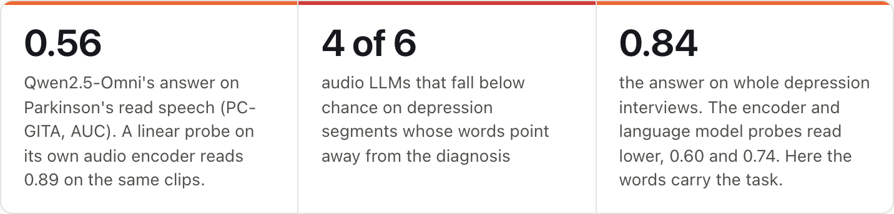
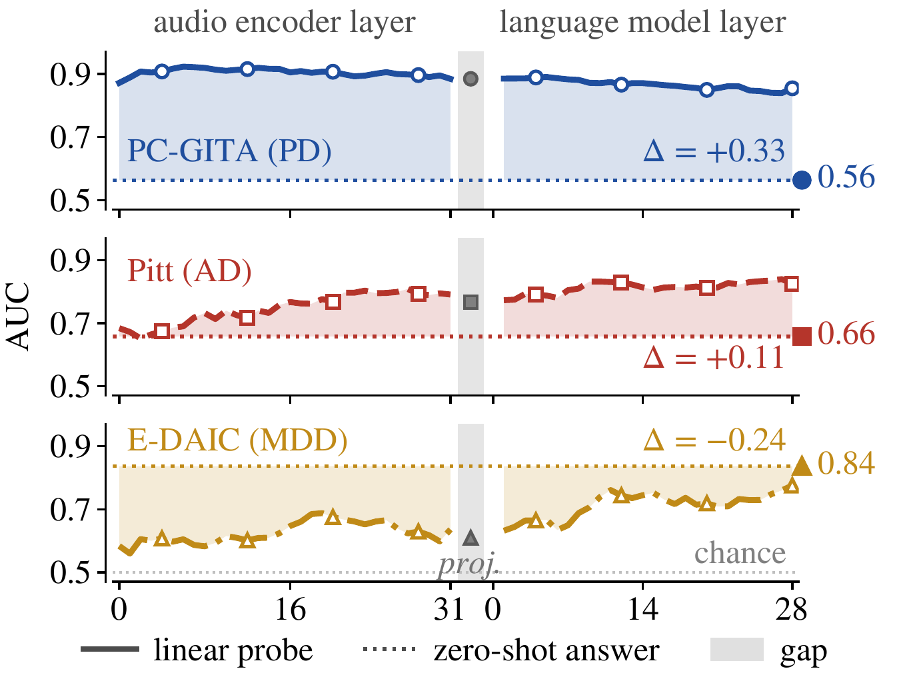
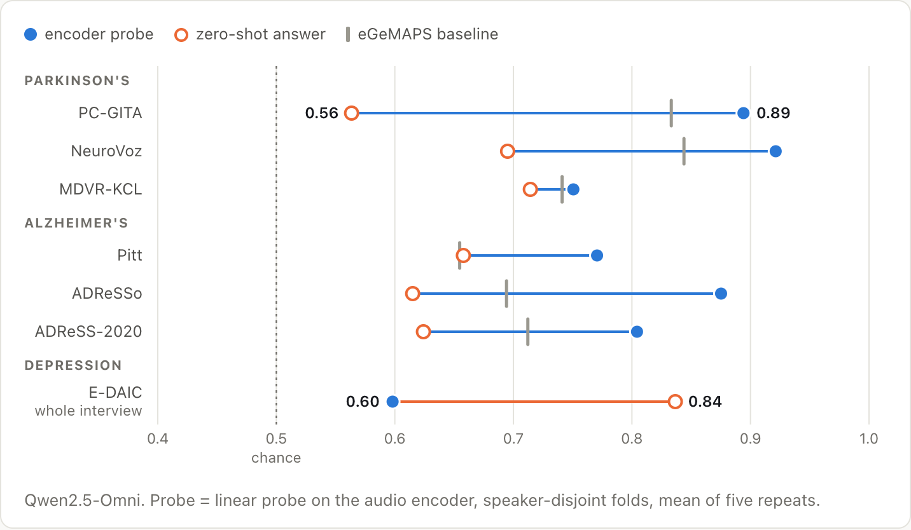
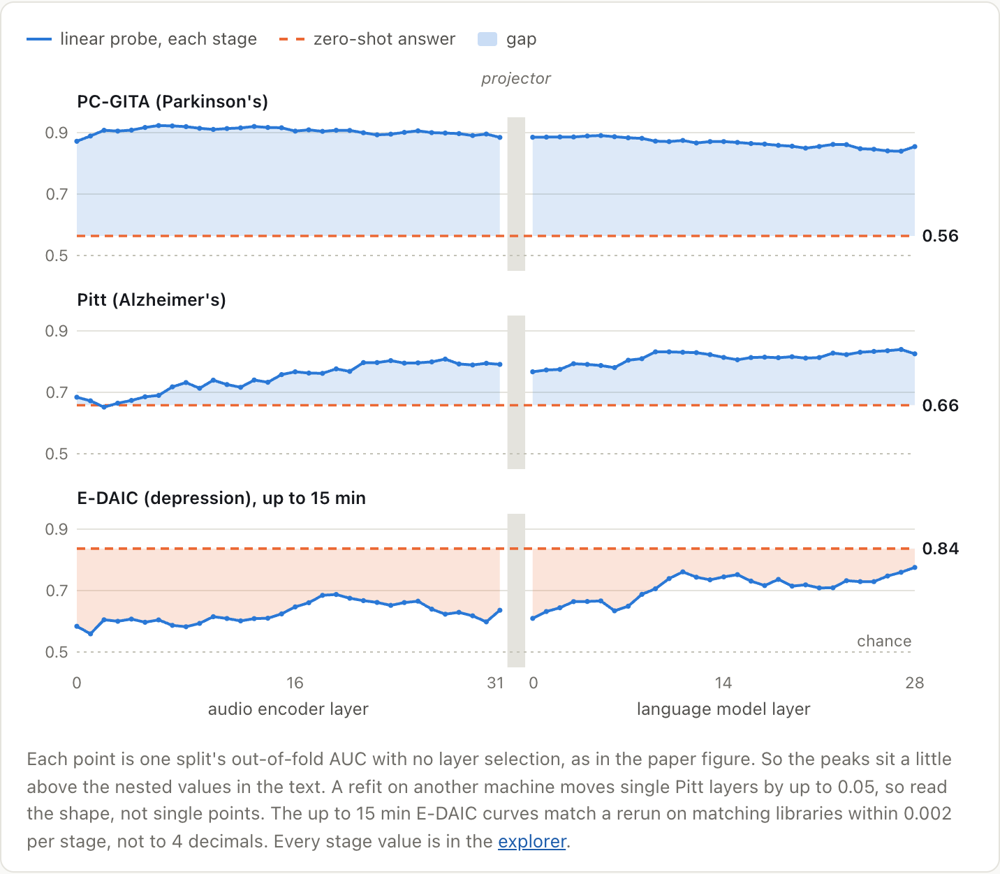
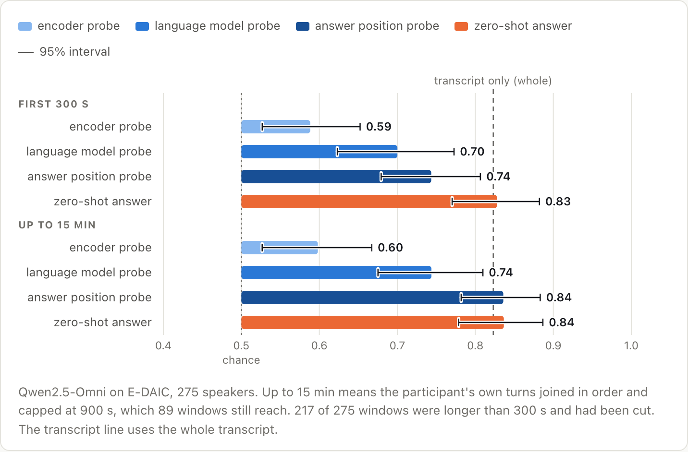
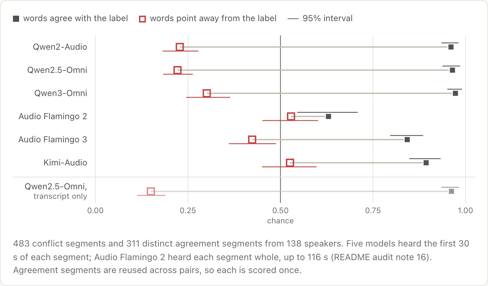
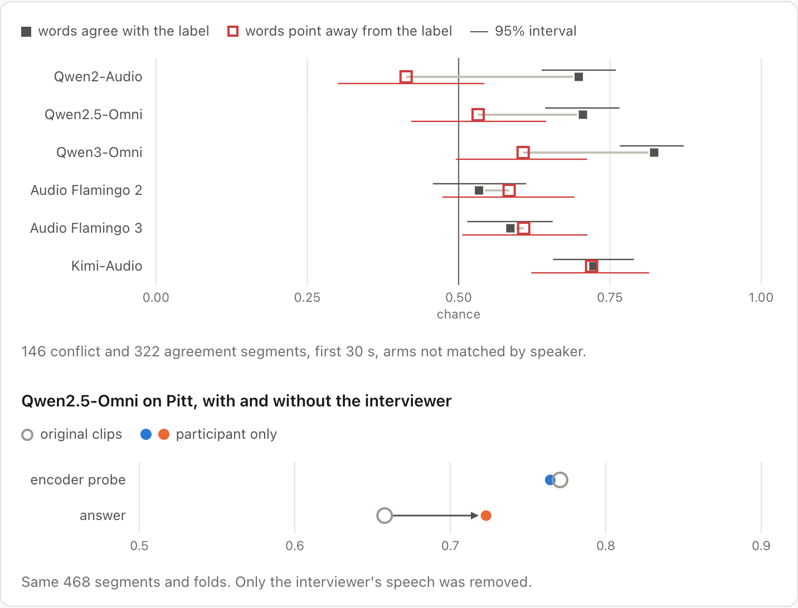
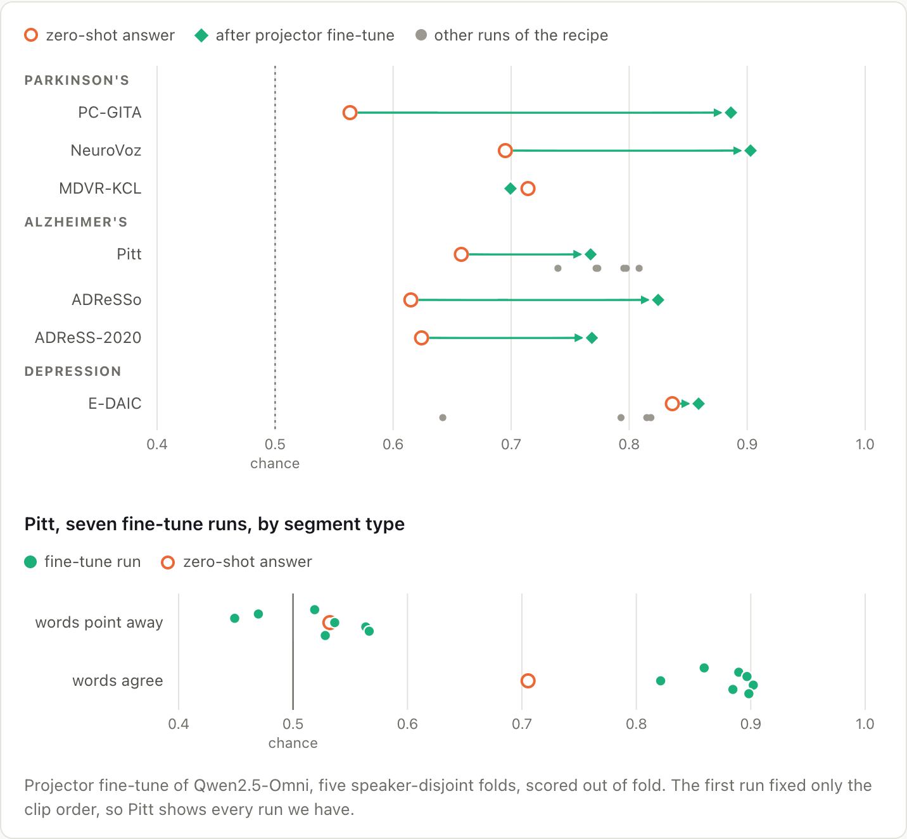

# The Representation Utility Gap in Audio LLMs for Clinical Speech

<p align="center">
<a href="https://cparw.github.io/audio-llm-utility-gap/"></a>
<a href="https://cparw.github.io/audio-llm-utility-gap/explorer.html"></a>

<a href="#citation"></a>
</p>

<p align="center">
Chaitanya Parwatkar, Nima Kelidari, Minoo Ahmadi, Ashutosh Chaubey, Mohammad Soleymani<br>
University of Southern California, Los Angeles, CA, USA<br>
Corresponding author: <a href="mailto:soleymani@ict.usc.edu">soleymani@ict.usc.edu</a>
</p>

<p align="center"><picture>
  <source media="(prefers-color-scheme: dark)" srcset="figures/page/headline-dark.png">
  
</picture></p>

Every score is AUC: 0.5 is chance and 1.0 is perfect. Intervals are 95 percent, from resampling speakers.

## Abstract

Recent advances in speech processing demonstrate the utility of speech as a robust clinical marker. Audio LLMs can
answer clinical questions about a recording in natural language, but their output depends on both paralinguistic and
linguistic cues, making it unclear how much is grounded in voice rather than text. In this paper, we compare
information from audio representations with responses generated by LLMs. We train linear probes on the frozen hidden
states of an Audio LLM and query models across three conditions that differ in language saliency: Parkinson's read
speech, depression interviews and Alzheimer's picture descriptions. On Parkinson's and Alzheimer's, probes detect
the disorder from audio representations with AUC ranging from 0.75 to 0.92, whereas the LLM's AUC is much lower due
to a representation utility gap. Where the words contradict the correct diagnosis, four of six LLMs fall below
chance. Fine-tuning the projector layer narrows this gap and boosts performance on Parkinson's and Alzheimer's. This
points to a utility gap between the information in speech representations and the outputs of Audio LLMs.

## Figure 1

<p align="center"></p>

Figure 1 of the paper, as submitted (`figures/fig1_gap.pdf`, shown here from `docs/assets/fig1_gap.png`). Each
panel prints Δ, the nested encoder probe minus the zero-shot answer.

## Results at a glance

These are the charts of the [project page](https://cparw.github.io/audio-llm-utility-gap/), where each one is
interactive. Every number in them has a row in the audit file,
[`records/AUDIT.md`](records/AUDIT.md), section f.

### On Parkinson's and Alzheimer's speech, the encoder holds more than the answer shows

Qwen2.5-Omni's own audio encoder holds more of the diagnosis than its answer shows. The probe reads 0.75 to 0.92
AUC. The answers sit at 0.56 to 0.71. The widest gap is on PC-GITA read speech, 0.89 against 0.56. On MDVR-KCL, with
37 speakers, the two are too close to call. A Qwen2-Audio encoder probe trained on PC-GITA and applied unchanged to
MDVR-KCL reaches 0.88, 0.29 above that model's own answer there, 0.59.

<p align="center"><picture>
  <source media="(prefers-color-scheme: dark)" srcset="figures/page/gap-dark.png">
  
</picture></p>

### The signal reaches the answer, but the Yes or No readout uses only part of it

The diagnosis is readable at almost every depth of the model, including the spot where the answer is made. At the
answer position, a probe on the final hidden state still reads 0.77. Along the one direction the model uses for Yes
or No, the two groups separate at only 0.66, the level of the answer itself.

<p align="center"><picture>
  <source media="(prefers-color-scheme: dark)" srcset="figures/page/layers-dark.png">
  
</picture></p>

### On depression interviews, the answer beats the encoder and language model probes

On whole E-DAIC interviews the answer reaches 0.84, while the encoder probe reads 0.60 and the language model probe
0.74. A probe at the answer position matches the answer, at 0.84. We also low-passed the whole interviews at 400 Hz,
which removes most of the words for Whisper. Yet the answer still reaches 0.76, a paired change of -0.08 (95 percent
interval -0.14 to -0.01).

<p align="center"><picture>
  <source media="(prefers-color-scheme: dark)" srcset="figures/page/depression-dark.png">
  
</picture></p>

### When the words point the wrong way, four of six models follow the words

Four of six models fall below chance on depression segments whose words point away from the label, with intervals
entirely under 0.5. Qwen2.5-Omni drops from 0.96 to 0.22. From the transcript alone, Qwen2.5-Omni gives 0.15 and 0.96.

<p align="center"><picture>
  <source media="(prefers-color-scheme: dark)" srcset="figures/page/conflict-edaic-dark.png">
  
</picture></p>

### On Alzheimer's speech the words matter too, and so does the interviewer

The three Qwen models drop by 0.17 to 0.29 from agreement to conflict, but none falls significantly below chance.
When we cut the interviewer's speech out, Qwen2.5-Omni's answer rose from 0.66 to 0.72, while the encoder probe
barely moved, from 0.77 to 0.76.

<p align="center"><picture>
  <source media="(prefers-color-scheme: dark)" srcset="figures/page/pitt-dark.png">
  
</picture></p>

### Retraining one small layer lifts the scores, but not where the words mislead

Retraining only the projector raised the answer on five of the six Parkinson's and Alzheimer's sets, from +0.11 on
Pitt to +0.32 on PC-GITA. On Pitt, in seven runs, the conflict segments stayed at chance, 0.45 to 0.57. On depression
the retrained projector stays at the zero-shot level: 0.86 against 0.84.

<p align="center"><picture>
  <source media="(prefers-color-scheme: dark)" srcset="figures/page/finetune-dark.png">
  
</picture></p>

## Repository layout

```
scores/       per-clip scores of every run with a sidecar json, clinical label column dropped
lookup/       master_lookup.csv: every cell of the paper with its AUC, n, estimator and source file
scripts/      the scripts behind the released numbers, and auc_from_perclip.py to recompute any AUC
folds/        the speaker fold assignments behind every probe
manifests/    segment lists and window cut points, speech and clinical columns removed
prompts/      the prompt strings
figures/      Figure 1 as submitted and the charts shown above
docs/         the project page and the interactive explorer
records/      the number-by-number audit (AUDIT.md), the issue log, the file manifest, run reports and
              earlier drafts, kept for the record
```

## Reproducing a number

```bash
pip install -r requirements.txt
```

The per-clip files carry no clinical label. To recompute an AUC, request each corpus from its owner (see below),
write its labels to a csv with an id column and a 0/1 label column, and run, for example, the E-DAIC zero-shot answer
of Table 1:

```bash
python scripts/auc_from_perclip.py \
    --scores scores/part23/A/A2_edaic_whole_zeroshot_perclip.csv \
    --id pid --speaker speaker --score p_yes_whole \
    --labels my_edaic_labels.csv --label-id pid --label-col label
```

This prints `AUC p_yes_whole: 0.8366 [0.7786, 0.8866]`, the value and 95 percent speaker bootstrap interval of the
paper. Add `--minus <column>` for a paired difference on the same bootstrap draws. To find the file behind any
number, look it up in [`records/AUDIT.md`](records/AUDIT.md), section f, or in `lookup/master_lookup.csv`.
Probe refits need the hidden states, which are not released.

## Data

No audio, no transcripts and no clinical label column are in this repository. The ids of each dataset's own release
are kept so that labels can be joined, and some ids still name the group (section b of the audit). The seven datasets come from their owners under their own licences or data-use
agreements: PC-GITA, NeuroVoz, MDVR-KCL, DementiaBank Pitt, ADReSSo, ADReSS-2020 and E-DAIC. What is and is not
released is listed in [`records/AUDIT.md`](records/AUDIT.md), section b.

## Audit

Every number in the paper was checked against the released files. [`records/AUDIT.md`](records/AUDIT.md) lists each
cell of Tables 1 and 2 and each number in the text with its file, sample size, estimator and status, including the
places where the submitted text and the files differ. [`records/DISCREPANCIES.md`](records/DISCREPANCIES.md) logs
every issue found and how it was resolved, and [`records/MANIFEST.txt`](records/MANIFEST.txt) lists every file with its
size and origin. Run logs, sidecars and scripts written before 12 October 2026 cite the record folders without the
`records/` prefix.

## Citation

```bibtex
@misc{parwatkar2026utilitygap,
  title  = {The Representation Utility Gap in Audio {LLMs} for Clinical Speech},
  author = {Parwatkar, Chaitanya and
            Kelidari, Nima and
            Ahmadi, Minoo and
            Chaubey, Ashutosh and
            Soleymani, Mohammad},
  year   = {2026},
  note   = {Submitted to ICASSP 2027},
  url    = {https://github.com/cparw/audio-llm-utility-gap}
}
```

## Contact

- Chaitanya Parwatkar, University of Southern California: [parwatka@usc.edu](mailto:parwatka@usc.edu)
- Ashutosh Chaubey, University of Southern California: [achaubey@usc.edu](mailto:achaubey@usc.edu)
- Mohammad Soleymani, University of Southern California (corresponding author):
  [soleymani@ict.usc.edu](mailto:soleymani@ict.usc.edu)
